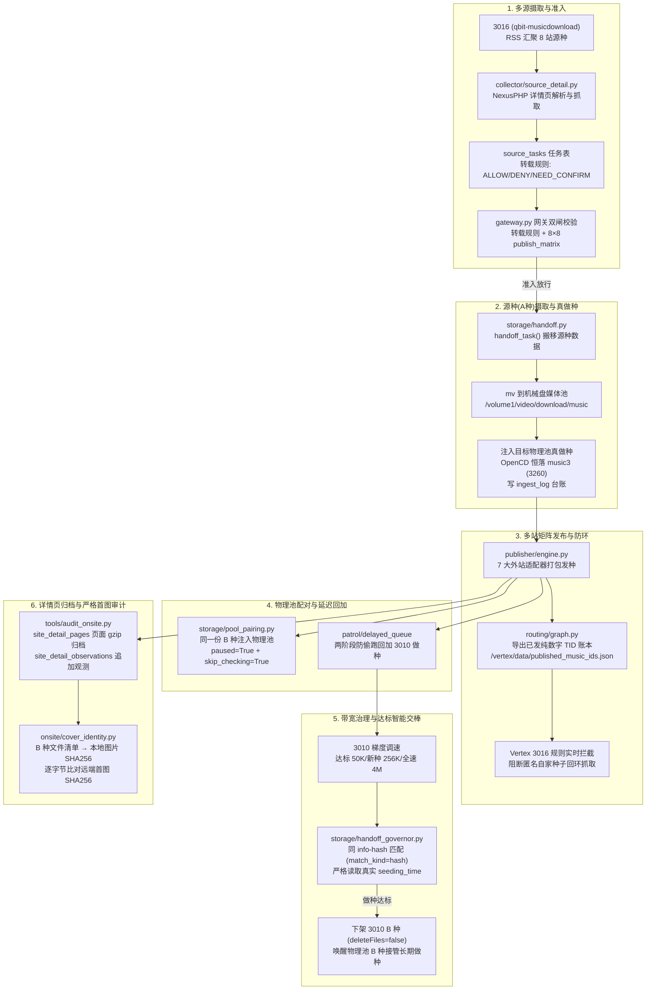

# MusicHub 3.0 —— PT 音乐矩阵自动化中枢

> **定位**：PT 音乐抓轨资源的全自动分发、做种配对、存储背压、详情页归档与生命周期管理中枢系统（脱胎自原 `opencd2others`，现已完全独立重构）。  
> **生产部署**：NAS 宿主容器 `musichub`（工作目录 `/volume2/docker_ssd/musichub`，网络模式 `host`）。  
> **开发与运维总规约**：参见 [AGENTS.md](AGENTS.md) 与统一技能规范 [skills/musichub/SKILL.md](../../skills/musichub/SKILL.md)。

---

## 一、系统全景架构与工作流

MusicHub 围绕音乐 PT 站的矩阵分发与生命周期治理构建，打通了从「多源摄取 → 准入门槛 → 多站分发 → 物理池配对 → 两阶段回加 → 智能交棒 → 详情页归档与首图审计」的完整闭环。



---

## 二、集群拓扑与基础设施

### 1. 端口与 qB 实例分工

集群采用职责分离架构，发种端、下载缓冲端与物理音乐保种池物理隔离：

| 实例名称 | 端口 | 容器名称 | 物理承载/职责 | 纳管策略 |
| --- | --- | --- | --- | --- |
| `qbit-publish` | **3010** | `qbit-publish` | 目标站 B 种初始做种与分发回加（host 网络） | 业务自管（不纳入 iyuu/QUI） |
| `qbit-musicdownload` | **3016** | `qbit-musicdownload` | 多站 RSS 源种摄取与下载缓冲池 | 业务自管（内置 QueueJanitor 清淤） |
| `music_pool_1` | **3210** | `qbit-music-1` | 机械盘音乐保种物理池 1（承接新 B 种负载） | 统一纳管（QUI / iyuu 纳管） |
| `music1` | **3220** | `qbit-music-2` | 机械盘音乐保种物理池 2（承接新 B 种负载） | 统一纳管（QUI / iyuu 纳管） |
| `music_pool_2` | **3230** | `qbit-music-3` | 机械盘音乐保种物理池 3（承接新 B 种负载） | 统一纳管（QUI / iyuu 纳管） |
| `music2` | **3240** | `qbit-music-4` | 机械盘音乐保种物理池 4（承接新 B 种负载） | 统一纳管（QUI / iyuu 纳管） |
| `music_pool_3` | **3250** | `qbit-music-5` | 机械盘音乐保种物理池 5（承接新 B 种负载） | 统一纳管（QUI / iyuu 纳管） |
| `music3` | **3260** | `qbit-music-6` | ★ **OpenCD 主库专属保种池，绝对不承接新 B 种负载** | 统一纳管（QUI / iyuu 纳管） |
| `music_pool_4` | **3270** | `qbit-music-7` | 机械盘音乐保种物理池 7（承接新 B 种负载） | 统一纳管（QUI / iyuu 纳管） |
| `music_pool_5` | **3280** | `qbit-music-8` | 机械盘音乐保种物理池 8（承接新 B 种负载） | 统一纳管（QUI / iyuu 纳管） |

> **物理池选池策略**：除 `music3`(3260) 锁死为 OpenCD 专用并排除外，其余 7 个物理池在注入配对时按实时任务数动态轮转（选择最空闲池 `EXCLUDED_LOAD_POOLS={"music3"}`）。

### 2. 存储与分卷规约

- **机械盘媒体存储**：`/volume1/video/download/music`（所有音乐池物理数据落点，仅同卷内允许建立硬链接）。
- **SSD 下载与发种缓冲**：
  - 3016 完成目录：`/volume2/qb_temp/completed_musicdownload`
  - 3010 发种目录：`/volume2/docker_ssd/qbit-all/data/publish/Download`
- **红线目录**：
  - `/volume1/video/download/music/music5`：用户独立下载目录，无 qB 任务引用，**硬拦截禁删**。
  - 系统目录黑名单：`incomplete`、`@eaDir`、`.RecycleBin`、`.OrphanedData`、`lost+found` 严禁误判为孤儿删除。

---

## 三、数据库全表架构字典 (`musichub.db`)

数据库由 `RoutingGraphManager._init_db()` 初始化，所有表均具备严格的职责边界与可审计性：

| 表名 | 主键 / 复合键 | 核心字段 | 职责定位与权威回答 |
| --- | --- | --- | --- |
| `source_tasks` | `info_hash` | `source_site`, `source_tid`, `transfer_rule`, `publish_after`, `meta_status`, `artist`, `album`, `cover_url`, `description`, `log_text` | **源种准入与元数据总表**：记录源种抓取状态、转载规则判定与解析字段 |
| `publish_matrix` | `(source_site, target_site)` | `allow`, `note`, `updated_at` | **发布矩阵门禁表**：定义多源多目标站点组合放行策略（默认放行，显式配置 `allow=0` 拦截） |
| `site_publish_graph` | `id` (递增) | `content_fingerprint`, `origin_site`, `origin_torrent_id`, `target_site`, `<site>_tid` (13列分列记账) | **发布关系与指纹拓扑表**：记录同一专辑内容发布到各站的数字 TID 映射（含 ubits_tid, soulvoice_tid） |
| `publish_lineage` | `(target_site, target_torrent_id)` | `origin_site`, `origin_torrent_id`, `b_hash`, `qb_instance`, `qb_port`, `save_path`, `local_path` | **发种血缘台账**：精确回答「某站某 TID 本地对应哪个 B 种、当前归属哪个物理池」 |
| `publish_attempt_log`| `id` (递增) | `content_fingerprint`, `target_site`, `result`, `reason`, `attempted_at` | **发种审计流水（只增不改）**：记录 PUBLISHED / SKIPPED / SKIPPED_EXISTING / REJECTED / FAILED |
| `pool_event_log` | `id` (递增) | `event_type`, `info_hash`, `instance_name`, `target_pool`, `reason`, `created_at` | **池生命周期事件流水**：记录 PAIR / HANDOFF / IN / OUT / CONFLICT 审计痕迹 |
| `cluster_infohash_registry` | `(info_hash, instance_name)` | `name`, `size_bytes`, `state`, `progress`, `updated_at` | **集群快照索引表**：维护 8 池内存元数据快照，加速查重，避免频繁拉取全量接口 |
| `site_detail_pages` | `(site, tid)` | `url`, `fetch_status`, `title`, `description_text`, `cover_url`, `raw_html_gzip`, `html_sha256`, `parser_version` | **已发布详情页数据库**：脱敏保存净化后的原始 gzip HTML、解析字段与首图 URL |
| `site_detail_observations` | `(site, tid, fetched_at)` | `seeders`, `leechers`, `completed`, `page_status`, `html_sha256` | **详情页时序观测表**：追加保存每次页面做种/下载计数变化，评估出种趋势 |
| `ingest_log` | `id` (递增) | `info_hash`, `target_instance`, `target_port`, `target_save_path`, `status`, `progress` | **源种摄取台账**：记录 A 种数据搬移到机械盘并在物理池真做种的物理落点 |
| `cover_cache` | `source_key` | `local_image`, `sha1`, `status`, `urls_json`, `verified_sha256` | **图床 URL 复用缓存**：仅作为减少重复上传的传输复用，不作内容身份证 |

---

## 四、核心运行机制与设计铁律

### 1. 准入门槛与多源分级（Gateway Policy）
- 3016 完成任务移交前，必须先经 `gateway.py` 执行准入策略：
  1. 源站转载规则校验：`transfer_rule != 'ALLOW'` 立即拦截（DENY 永久拒绝；NEED_CONFIRM 需人工确认）。
  2. 等待期校验：`now < publish_after` 拦截等待。
  3. 矩阵校验：`publish_matrix(source_site, target_site).allow == 0` 立即拦截。
  4. 元数据完整性分级：`meta_status == 'NEED_META'` 时，严格站（如 OpenCD 目标站 `metadata_strict=True`）暂缓发种，宽松站允许降级发种。

### 2. 源种（A 种）搬移真做种
- 3016 任务完成后的搬移是 **mv 而非 copy**，避免 SSD 空间双重占用。
- 必须解析 `.torrent` 获取真实 info-hash，先注入物理池（`paused=False + skip_checking=True`），在 `verify_timeout`（30s）内回读确认 `progress≈1` 后，方可下架 3016 任务。
- **OpenCD 专属铁律**：`opencd` / `open.cd` 源种恒落 `music3` (3260)，fail-closed 拦截非 3260 目标。

### 3. 发布期物理池配对与延迟回加
- B 种发布成功后，首先调用 `storage/pool_pairing.py`，将**同一份 B 种字节**注入至承载物理池，初始状态固定为 `paused=True + skip_checking=True`。
- 配对前必须执行同卷硬链接补齐，并全集群单实例查重；落盘记账 `PAIR` 事件。
- 3010 发种端通过两阶段延迟队列（`delayed_readd`）接管，初始提供高带宽种子爬坡。

### 4. 3010 达标智能交棒（Handoff Governor）
- 独立常驻线程 `HandoffGovernorThread`（120s/轮、批量流水线）。
- **交棒判据**：严格要求同 info-hash 匹配（`match_kind=hash`）；旧 `name+size` 规则已彻底废止，绝不唤醒 A 种删除 B 种。
- **做种时长**：严格读取 qB `seeding_time`，严禁使用墙钟时间 `now - added_on` 冒充。
- **交接时序**：先 stop 3010 任务 → 批量唤醒物理池对应任务并验证 100% → 下架 3010 任务（`deleteFiles=false` 恒成立）。

### 5. 3016 队列治理、阶梯调速与 Vertex 48h 死种闭环
- **阶梯调速与轮转激活**：正式纳管至 `MultiPoolDownloadGovernor`（每 15s 巡检），执行五档精细阶梯控速、小包优先、300s 无源超时让位与全队列多轮轮转探活，彻底根治槽位死锁；
- **Vertex 48h 终态回收**：部署专用删种规则 `c8a1b205`，对加入满 48 小时且未完成（`progress < 1.0`）的无源死种彻底清理下架（`onlyDeleteTorrent: true`，保护做种态资产）；
- **自建清道夫退役**：MusicHub 内部原 `DownloadQueueJanitor` 线程正式退役，未成活死种垃圾回收全权交还 Vertex 闭环管理。
- **Vertex 防环账本**：每次发种成功后，原子导出已发纯数字 TID 至 `/vertex/data/published_music_ids.json`，Vertex 规则 `30160002.json` 实时比对拒收，彻底解决自环重抓。

### 6. 详情页整表覆盖与首图严格字节闸门
- `takeedit.php` 必须先 GET `edit.php?id=` 读取全表基线，只改目标字段后提交，防止清空站点其他字段。
- **首图字节闸门**：
  $$\text{B 种文件清单} \to \text{本地封面 SHA256} \equiv \text{图床 GET 返回图片 SHA256} \equiv \text{站点首图 SHA256}$$
  严格模式下禁止重编码原图，超限或无法取得原字节 URL 时保持 blocked，严禁用派生图冒充原图。

### 7. 集群查重与「多处做种」告警分诊
- 站点报告 `You cannot seed the same torrent from more than 1 client`：
  - **live_duplicate**（全集群 ≥ 2 个 active 实例）：编排失误，必须收敛为单实例。
  - **stale_seat**（全集群仅 1 个 active 实例）：qB 重启换 `peer_id` 导致站点旧 session 未过期，**严禁删加任务或动文件**，静待站点 TTL 过期。

### 8. 8 个音乐 QB 多池下载阶梯调速与常态化管理 (MultiPoolDownloadGovernor)
- 独立常驻线程 `DownloadGovernorThread`（15s/轮，全矩阵纳管 8 个音乐实例：`music3`, `music1`, `music2`, `music_pool_1~5`）。
- **五档阶梯限速模型**（精准对标用户参考方案）：
  - 档位 1（0% ~ 10%）：初始预热低速 `1.0 MiB/s`（平稳握手建连，防并发突发暴涌抢占带宽）；
  - 档位 2（10% ~ 20%）：爬坡加速低速 `2.5 MiB/s`（前 20% 低速过渡）；
  - 档位 3（20% ~ 70%）：主力冲刺极速 `5.0 MiB/s`（单种最高 5MB/s，拉满下行带宽）；
  - 档位 4（70% ~ 90%）：高位稳态高速 `4.0 MiB/s`（20%~90% 高速区间后半程）；
  - 档位 5（90% ~ 100%）：尾盘减速防抖 `1.5 MiB/s`（最后 10% 减速收敛，防磁盘寻道与写缓冲区阻塞）；
- **20 并发槽位管理**：每个实例默认 20 个并发槽位，超出槽位的待完成任务自动保持 paused，优先调度小包（`size_asc`），100% 转正做种后毫秒级唤醒后续任务。
- **底层偏好自愈**：各实例单种最大连接数放开至 25，全局连接数放开至 1000，下载并发上限放开至 60。
- **母种绝对保护**：对 `progress >= 1.0` 的在保母种绝对不动、不限速、不删除。

---

## 五、运维工具链地图 (CLI Toolchain)

项目在 `musichub/tools/` 下内置了完备的正式运维工具链：

| 工具脚本 | 核心功能 | 默认操作 | 写入参数与保护边界 |
| --- | --- | --- | --- |
| `audit_onsite.py` | 详情页归档、页面完整性/封面/B 种统一审计 | `--sync` 列出归档计划；`--audit` 只读审计输出表格或 JSON | `--sync --apply` 仅写入详情页库，绝不动站点或 qB；`--limit=0` 不截断 |
| `find_lineage.py` | 按 tid、源 hash、B hash 追踪发布血缘并现场探针 3010+8 池 | 默认全集群只读探针；`--fetch` 仅网络下载 torrent 反查 hash | 无任何写入选项（纯只读） |
| `repair_seeding.py` | 3010 与物理池全缺失、唯一 paused 等断种安全恢复标准入口 | 默认 dry-run；解析 B 种、查重、核对磁盘实体清单 | `--apply` 严格通过七道闸门后执行配对或 resume，绝不删任务/文件 |
| `edit_onsite.py` | 站点详情页体检、字段整表覆盖修改、简介修复与首图更换 | `--check`、`--scan` 只读扫描与 dry-run 体检 | `--apply --yes` 显式写入；封面须过严格身份与 SHA256 闸门 |
| `cluster_dedupe.py` | 集群同 hash 查重与「多处做种」陈旧占位分诊工具 | 默认扫描与 `--seats 200` 均为只读分诊 | `--apply` 仅限收敛 live duplicate，`deleteFiles=false` 恒成立 |
| `backfill_pool_pairing.py`| 针对 3010 存量未交棒 B 种补物理池 paused 配对 | 默认 dry-run 输出待配对清单 | `--apply --only-missing` 注入物理池，不替代全集群缺失恢复 |
| `rebuild_source_seeds.py`| 源种（A 种）实体数据核验与做种回填 | 默认只读核验；解析种子、核对磁盘文件完整性 | `--apply` 注入目标池（OpenCD 恒落 music3），回读 100% 记录台账 |
| `backfill_source_tasks.py`| 历史源种任务补全至 `source_tasks` 表 | 默认 dry-run 输出补全清单 | `--apply` 写入数据库，支持历史欠账补发 |
| `backfill_site_tids.py` | 历史发布图谱按站点独立列拆分回填 | 默认只读体检 | `--apply` 幂等回填 `site_publish_graph` 各站纯数字 tid |
| `ordered_downloader.py` | 8 个音乐 QB 实例有序并发下载与五档阶梯调速器 | `--status` 体检概况；`--dry-run` 预览排队；`--pool all` 全矩阵看板 | 20 并发稳态；五档阶梯调速 (1M/2.5M/5M/4M/1.5M)；`--concurrency N`；`--stop-all` 紧急制动 |
| `fix_musopia_logfolds.py`| 修复乌托邦日志折叠框语法 | 默认 dry-run | `--apply` 提交修复 |

### 常用运维操作速查

```powershell
# 1. 详情页增量归档与只读审计
python musichub/tools/audit_onsite.py --sync --apply --site xingwan --tid 4365
python musichub/tools/audit_onsite.py --audit --site xingwan --tid 4365 --format json

# 2. B 种断种安全恢复（先干跑，后应用）
python musichub/tools/repair_seeding.py --scan
python musichub/tools/repair_seeding.py --target tangpt:72455 --target xingwan:4365 --apply --format json

# 3. 集群多处做种告警分诊
python musichub/tools/cluster_dedupe.py --seats 200

# 4. 存量母种反查与本地数据库 TID 回填
python musichub/tools/backfill_canonical_origins.py --scan
python musichub/tools/backfill_canonical_origins.py --limit 0 --apply

# 5. 官方下载种子 Comment 详情页直链安全注入（保持 info_hash 不变）
python musichub/tools/patch_torrent_comments.py --scan
python musichub/tools/patch_torrent_comments.py --apply

# 6. 在线详情页来源引用死链识别与标准直链修缮
python musichub/tools/edit_onsite.py --scan --days 30 --fix-source-link
python musichub/tools/edit_onsite.py --site tangpt --days 30 --fix-source-link --apply --yes
```

---

## 六、历史排查复盘与遗留事项跟踪看板

通过对 CodeBuddy 与 Trae 历史会话、执行计划及现场复盘文档的深度梳理，梳理出当前项目的交付与遗留状态：

### 1. 已完成核心里程碑（Done）

- [x] **3016 队列清淤与防环彻底解决**：清理 59 个 stalledDL 死种与 26 个自环任务；关闭 `dont_count_slow_torrents`；Vertex 侧接入防环账本拦截；常驻 `DownloadQueueJanitor` 自动巡检。
- [x] **达标智能交棒机制根治**：废止旧 `name+size` 错误接管逻辑，重构为 `match_kind=hash`；改用真实 `seeding_time`；存量交棒前必须先物理池配对。
- [x] **源种（A 种）真做种保障**：彻底修复旧链路搬移文件不注入做种的缺口；OpenCD 恒落 3260；存量 38 条源种已全部在册做种。
- [x] **详情页数据库建立与统一归档**：上线 `site_detail_pages` 与 `site_detail_observations`；脱敏存储；完成 115 项去重目标的集中归档与审计。
- [x] **38 个做种异常目标安全恢复**：36 项可行动目标已恢复或验证为唯一 active 做种（含星湾 4365 孤儿恢复、TangPT 72455/72453 原地 resume 等）。
- [x] **多站独立 tid 分列记账**：在 `site_publish_graph` 中开辟 11 个站点的纯数字 tid 列，完成历史存量数据清洗与回填。
- [x] **严格首图字节身份与上传闸门**：封堵 PicGo duplicate 重编码漏洞，确立六环闭环身份链与预提交远端 SHA256 逐字节比对机制；20 项存量合格封面正式写入 NAS 验证 100% 通过。
- [x] **集群多处做种告警科学分诊**：明确 `live_duplicate` 与 `stale_seat` 判定标准；制定 qB 重启纪律。
- [x] **技能源统一合并**：将分散的技能合并为统一权威的 `skills/musichub/SKILL.md`，并在四套 Agent 环境建立 Junction 映射。
- [x] **UBits 站点矩阵完整接入**：完成适配器 `UBitsAdapter` 逆向与实现（`cat=406`, `type=406`, `medium_sel[4]=8/9`, `uplver=yes`, `_token` 表单提权）；更新 `site_rules.py`、`graph.py`（扩充 `ubits_tid`）、`source_detail.py`、`daemon.py` 与 `edit_onsite.py`；Vertex 3016 防环规则 `30160002.json` 接入 `ubits`，RSS 任务 `30160003.json` 挂载音乐分类专属订阅；生产端已热挂载并平滑生效。
- [x] **SoulVoice (聆音Club) 站点矩阵完整接入**：完成适配器 `SoulVoiceAdapter` 逆向与实现（`type=408`, `medium_sel[4]=10/11/12`, `codec_sel[4]=5`, `standard_sel[4]=4`, `team_sel[4]=5`, `hr[4]=0`, `uplver=yes`）；更新 `site_rules.py`、`graph.py`（扩充 `soulvoice_tid` 列与别名 `sv`）、`source_detail.py`（源站识别）、`stock_pump.py`、`daemon.py`；Vertex 3016 防环规则 `30160002.json` 扩充 `soulvoice` 账本匹配，RSS 任务 `30160003.json` 挂载聆音音乐区专属订阅（`cat408=1`）；本地及 NAS 容器单元测试 100% 通过。
- [x] **母种反查杂质清洗与多层中继站套娃穿透**：修复目录名前置年份与流媒体平台词干扰导致母种检索落空的问题；重构 `resolve_canonical_source`，自动穿透乌托邦等中继站，规范生成向原制作者致谢（JPopsuki / Redacted 等）；严格落实 local/unknown 留空防伪红线。
- [x] **纯 Python Bencode 种子 Comment 安全注入**：开发独立 Bencode 编解码引擎，发种回加前自动向官方种子顶层注入 `https://<domain>/details.php?id=<tid>` 注释，保持 `info` 字典与 `info_hash` 恒定不变；上线 `patch_torrent_comments.py` 批量补齐工具。
- [x] **存量母种对账与分站详情页在线修缮（阶段 1 & 阶段 2）**：完成 120 张存量专辑母种 TID 闭环回填，纯数字 TID 覆盖率达 97.4%；完成 `lemonhd#48887` 及首批 4 站 43 条详情页在线修缮，100% 成功。
- [x] **18 个断种紧急恢复做种达标**：自动化排查并全量恢复 18 个发种后未做种任务，分流注入物理池并唤醒，做种进度达到 100%。

### 2. 遗留与待处理事项看板（Pending / Blocked / 待决策）

| 事项类别 | 目标对象 / 任务名称 | 当前状态 | 现状细节与阻塞根因 | 建议处置方案 |
| --- | --- | --- | --- | --- |
| **站点写入** | 24 项已核验合格的封面补写 | **Eligible (待用户确认写入)** | 第二次 dry-run 中 24 项已取得与原图 SHA256 完全一致的合格 URL 并通过整页 dry-run，但此前受整批护栏（26/26）约束未执行 `--apply` | 用户确认后，可通过 `python musichub/tools/edit_onsite.py` 拆批或统一 `--apply --yes` 写入站点 |
| **权限阻塞** | PterClub `904277 / 904276` | **Blocked (外部权限失效)** | MusicHub 台账明确存在发布映射，但当前访问详情页与取种链接均返回「ACCESS_DENIED / 你没有该权限！」，无法解析 B 种，未改 qB | 维持 blocked，向站点管理组核实该账号发布权限与种子状态 |
| **图床阻塞** | 星湾 XingWan `4368` 封面 | **Blocked (合格远端 URL 缺失)** | 本地原图与数据库旧缓存均在，但 PicGo 报 duplicate 且无 URL，Lsky 也未返回原字节 URL；严格模式禁止重编码，保持 blocked | 待图床支持原图回收，或通过合规备用图床上传原图并复核 SHA256 |
| **站点已删** | 麒麟 HDKylin `478248` (Kirk Whalum) | **Confirmed Deleted (站点已删)** | 确认为 MusicHub 历史发布（graph 2854），B hash 为 `edd7fd43…`；站点因断种过久已自动删除，当前全集群缺失 | 因站点已无该种子，无需在 qB 补种；如需保种需走全新发布流程 |
| **未恢复做种**| 历史封面目标中的 9 个 `B_MISSING` | **Pending (未纳管在本次恢复)** | `crabpt 238856/238646`、`hdkylin 478159/477829`、`pterclub 912321`、`tangpt 72404`、`xingwan 4303`、`hdtime 238262`、`musopia 28079` 当初仅作封面审计，未纳入 38 个恢复目标 | 按需调用 `python musichub/tools/repair_seeding.py --target <site>:<tid>` 进行逐项恢复 |
| **生产部署** | 多源准入改造与 NAS 容器更新 | **Pending (待非黄金窗口验证)** | 代码层面已支持 `source_tasks`、`publish_matrix`、`source_detail.py`，但尚未在生产端重启验证 | 需在东八区 10:00 之后，在无在途发种时通过 `docker compose up -d --force-recreate musichub` 重启生效 |

---

## 七、开发与维护守则

1. **改动前后必自检**：
   ```powershell
   python -m py_compile musichub/daemon.py
   $env:PYTHONPATH="."
   python musichub/tests/test_core.py
   python musichub/tests/test_handoff_governor.py
   python musichub/tests/test_repair_seeding.py
   python musichub/tests/test_onsite_descr.py
   ```
2. **黄金发种窗口（00:00 - 10:00）严禁重建容器**。
3. **永远遵守单实例与 `music5` 禁删红线**。
